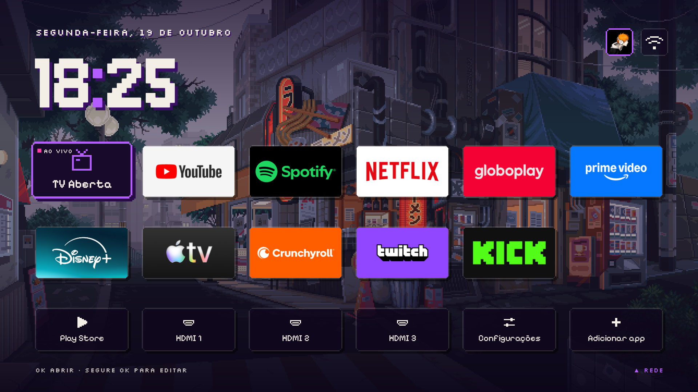

<div align="center">

# TV Detox Pixel

### Deixe sua Android TV leve, sem propaganda e com uma home "Neon roxo 8-bit".

Sem root. Nada é desinstalado. Tudo tem como desfazer.



<sub>Print real de uma Aiwa SWTV-20SA. O fundo animado e o avatar são do dono da TV e <b>não vêm no repositório</b>: coloque os seus em <code>assets/</code>.</sub>

</div>

- **Visual Neon roxo 8-bit:** fontes pixel (Jersey 10, Pixelify Sans, Silkscreen), blocos com cantos em degrau, sombra dura, ícones em pixel.
- **TV Aberta:** primeiro bloco da home, que abre **sempre na antena**, mesmo se você usou uma HDMI antes.
- **Fundo animado (GIF) e avatar** opcionais, só no seu computador (não vão para o GitHub).
- **Ligar a TV sempre cai na home:** tanto reiniciando quanto saindo do standby.
- **Ferramentas de limpeza com log** (`tools/`): cada mudança é anotada com o comando que desfaz, e um `desfazer-tudo.sh` é gerado sozinho.

> [!NOTE]
> Isto funcionou em TVs reais, mas não é suporte oficial de nenhuma marca. Use por sua conta e risco. Antes de mudar qualquer coisa, faça o backup (passo 3).

---

## Quais TVs funcionam

Precisa ser **Android TV ou Google TV** (Android 9 ou mais novo). Para conferir: **Configurações › Sobre** (ou **Sistema › Sobre**) tem que mostrar "Android TV OS" ou "Google TV".

| Funciona ✅ | Funciona em parte ⚠️ | Não funciona ❌ |
|---|---|---|
| TVs Android TV / Google TV: **TCL e Semp TCL** (linhas Android/Google TV), **Philips** (Android), **Sony Bravia**, **Xiaomi**, **Aiwa**, **Philco** e **Hisense** nos modelos Android/Google TV | **Amazon Fire TV:** a limpeza funciona, mas a Amazon bloqueia trocar a home | **Samsung** (sistema Tizen) |
| Aparelhos ligados na HDMI: **Chromecast com Google TV**, **Google TV Streamer**, TV Box Android, Mi Box, Nvidia Shield | Projetores Android "genéricos": depende de terem Opções do desenvolvedor | **LG** (sistema webOS) |
| | | **Roku TV** (TCL Roku, Philco Roku, AOC Roku…), **Hisense VIDAA** |

Testado de verdade numa **Aiwa SWTV-20SA** (por dentro é Skyworth/MediaTek, Android TV 11). 
### E Samsung e LG?

**Não dá para instalar esta home nelas.** Samsung usa **Tizen** e LG usa **webOS**: não são Android. Elas não têm o modo de depuração (`adb`), nem aceitam instalar apps de fora da loja nem trocar a tela inicial. Nenhum script consegue mudar isso sem desbloqueios que anulam a garantia, e este projeto não faz isso.

O que você **pode** fazer:

**1. Ter esta home numa Samsung ou LG pela HDMI (recomendado).** Ligue um **Chromecast com Google TV**, **Google TV Streamer** ou TV Box Android numa HDMI e instale a home nele, seguindo o passo a passo abaixo.
- Ative o **HDMI-CEC** na TV: na Samsung se chama **Anynet+**, na LG **SIMPLINK**. Assim, ligar o aparelho liga a TV e já muda para a HDMI dele.
- Na própria TV, deixe essa HDMI como entrada ao ligar, se o modelo tiver essa opção.

**2. Cortar propaganda e rastreamento nos menus da própria TV.** Os nomes mudam conforme o ano do modelo, então procure por palavras parecidas.

- **Samsung (Tizen):**
  - **Configurações › Suporte › Termos e Políticas** (ou **Termos e Privacidade**): desligue **Serviços de Informações de Visualização**, que é o reconhecimento do que passa na tela para anúncios, e **Anúncios baseados em interesses**.
  - **Configurações › Geral › Recursos do Smart:** desligue a execução automática do Smart Hub, se não quiser que ele abra ao ligar.
- **LG (webOS):**
  - **Configurações › Geral › Sistema › Configurações adicionais › Configurações da tela inicial:** desligue **Promoção na tela inicial** e **Recomendação de conteúdo**.
  - **Configurações › Geral › Sistema › Configurações adicionais:** desligue **Live Plus**, o reconhecimento de conteúdo.
  - **Configurações › Geral › Sistema › Contratos do usuário:** desmarque o que for sobre **informações de visualização** e **anúncios**.

---

## Passo a passo

### 0. O que você precisa

- Um computador (Mac, Linux ou Windows com **Git Bash**) na **mesma rede** da TV.
- O **adb**:
  - **Mac:** `brew install android-platform-tools`
  - **Windows:** baixe o [SDK Platform Tools](https://developer.android.com/tools/releases/platform-tools).
  - **Linux:** `sudo apt install adb`
- Este repositório: `git clone https://github.com/LuanRobson/tv-detox-pixel && cd tv-detox-pixel`

### 1. Liberar o modo desenvolvedor na TV

1. **Configurações › Preferências do dispositivo › Sobre** (ou **Sistema › Sobre**).
2. Aperte OK em **Versão** (ou **Build**) **7 vezes**, até aparecer "Você agora é um desenvolvedor".
3. Volte, abra **Opções do desenvolvedor** e ligue **Depuração USB**. Se existir **Depuração pela rede** ou **Depuração sem fio**, ligue também.
4. Anote o IP da TV em **Configurações › Rede**.

### 2. Conectar o computador à TV

```sh
adb connect 192.168.1.50:5555      # troque pelo IP da sua TV
adb devices                         # tem que aparecer "device"
```

Na primeira vez a TV pergunta **"Permitir depuração?"**: marque **Sempre permitir** e aperte **Permitir**.

Para não repetir o IP em todo comando:

```sh
export DEV=192.168.1.50:5555
```

### 3. Backup (antes de mudar qualquer coisa)

```sh
tools/backup.sh antes
```

Isso salva em `backup/<data>-antes/`:
- **Apps:** a lista de todos, dos ativos e dos desligados.
- **Configurações:** todas, dos grupos `global`, `system` e `secure`.
- **Memória:** o uso de memória daquele momento.

Nada na TV muda.

> Algumas TVs mostram um valor absurdo de "MemAvailable" no `/proc/meminfo`. Compare pelo **"Used RAM"** do arquivo `dumpsys-meminfo.txt`.

### 4. (Opcional) Desligar propaganda e telemetria

Liste os apps e decida, **um de cada vez**:

```sh
adb -s $DEV shell pm list packages -s     # apps de sistema
adb -s $DEV shell pm list packages -3     # apps que você instalou
```

Desligue com o `tools/mudar.sh`. Ele usa `pm disable-user` (não desinstala), anota no `mudancas.log` e atualiza o `desfazer-tudo.sh`:

```sh
tools/mudar.sh desligar com.google.android.tvrecommendations "recomendações na home"
```

O que costuma ser seguro desligar (confira se existe no seu modelo):

| Pacote | O que é |
|---|---|
| `com.google.android.tvrecommendations` | Recomendações do Google na home |
| `com.google.android.backdrop` | Modo ambiente, o protetor de tela com sugestões |
| `com.google.android.feedback` | Envio de feedback ao Google |
| `com.google.android.videos` | Google TV/Play Filmes (só se você não aluga filmes) |
| `*.acr.*` ou nomes com "acr" | Reconhecimento do que passa na tela, para anúncios |
| `com.google.android.katniss` | Assistente/busca por voz (o botão de microfone para de funcionar) |
| `com.google.android.apps.mediashell` | Chromecast integrado (você perde a opção de transmitir do celular) |

**Nunca desligue:**
- **TV, antena e HDMI:** nomes com `tv`, `tvinput`, `tuner`, `dtv`, `atv`, `hdmi`, `cec`, `livetv`.
- **Imagem, som e fábrica:** nomes com `picture`, `sound`, `factory`.
- **Controle, Bluetooth e teclado.**
- **Google:** `com.google.android.gms`, Google Play (`com.android.vending`), WebView.
- **Sistema:** Configurações (`com.android.tv.settings`), SystemUI, o app de configuração inicial (`setupwraith`) e a atualização de sistema.
- **Fabricante:** apps da marca, como Skyworth (`smartdevice`), MediaTek, TCL e outras. Na dúvida, deixe ligado.

### 5. Animações e protetor de tela

```sh
tools/mudar.sh setting global window_animation_scale 0 "animações"
tools/mudar.sh setting global transition_animation_scale 0 "animações"
tools/mudar.sh setting global animator_duration_scale 0 "animações"
tools/mudar.sh setting secure screensaver_enabled 0 "protetor de tela"
```

O valor antigo de cada um fica guardado no log.

### 6. Instalar a home

**Jeito rápido (APK pronto, sem fundo e sem avatar):**

```sh
sh install.sh $DEV "com.google.android.youtube.tv,com.netflix.ninja,com.spotify.tv.android"
```

A lista entre aspas são os apps da home, em ordem. A **TV Aberta** entra sozinha na frente se a TV tiver antena. Sem lista, ele escolhe os apps por você.

**Jeito completo (compilar, com o seu fundo e o seu avatar):**

1. Instale Java 17 e o Android SDK:
   ```sh
   brew install openjdk@17
   brew install --cask android-commandlinetools
   sdkmanager "platforms;android-34" "build-tools;34.0.0"
   ```
2. Coloque suas imagens em `assets/`: `wallpaper.gif` (ou `.jpg`) e `avatar.jpg`. Veja `assets/LEIA-ME.md`.
3. Edite `apps.txt` com os seus apps (um pacote por linha).
4. Compile e instale:
   ```sh
   sh build.sh
   sh install.sh $DEV
   ```

O `install.sh` faz o resto:
- **Home padrão:** registra a home nova como padrão.
- **Ligar sempre na home:** concede as duas permissões para isso (**sobrepor a outros apps** e **acesso ao uso**).
- **Home antiga:** **pergunta** antes de desligar a home do fabricante. Em muitas TVs ela tem prioridade e continua abrindo enquanto estiver ligada.

> Guarde o `key.jks` que o primeiro `build.sh` cria. As atualizações precisam da mesma chave.

### 7. Reiniciar e conferir

```sh
adb -s $DEV reboot
```

Depois que a TV ligar, confira:
- **Abre na home nova.** Em algumas TVs aparece o Live TV por 10–25 s e depois a home entra sozinha.
- **TV Aberta:** abre a antena, mesmo vindo de uma HDMI.
- **Standby:** desligar pelo controle e ligar de novo cai na home.
- **Backup do depois:** rode `tools/backup.sh depois` para comparar a memória.

---

## Usando a home

- **Setas:** navegam. **OK:** abre.
- **Segurar OK:** abre o menu do app (Mover, Substituir, Remover, Informações). Em algumas TVs a tecla MENU abre o painel da própria TV, então use **segurar OK**.
- **Adicionar app:** fica na linha de baixo. Os apps passam para a linha de baixo a cada seis.
- **Seta para cima:** chega no ícone de rede.
- **Fundo animado:** toca só com a home na tela. Abrindo um app, ele pausa e não gasta processamento.

## Desfazer

| Para desfazer | Comando |
|---|---|
| Tudo o que você fez com `tools/mudar.sh` | `./desfazer-tudo.sh` |
| Só a home (religa a home original e remove esta) | `sh undo.sh $DEV` |
| Qualquer app desligado, na mão | `adb -s $DEV shell pm enable <pacote>` |

### A TV ficou reiniciando sem parar

O computador costuma conseguir conectar por alguns segundos a cada reinício. Religue tudo o que estiver desligado:

```sh
adb connect $DEV && adb -s $DEV wait-for-device
for p in $(adb -s $DEV shell pm list packages -d | tr -d '\r' | sed 's/package://'); do adb -s $DEV shell pm enable "$p"; done
```

---

## Detalhes técnicos

- **TV Aberta:** usa a primeira entrada de sintonizador do sistema (`TvInputInfo.TYPE_TUNER`) e abre `content://android.media.tv/channel?input=<id>`. Esse é o jeito padrão do Android TV de "assistir esta entrada": troca para a antena mesmo que a última fonte tenha sido uma HDMI. Se a TV não tiver sintonizador, o bloco some.
- **Ligar sempre na home:**
  - **Saindo do standby:** um aviso de "tela ligada" traz a home para a frente.
  - **Reiniciando:** a home espera o aviso de "terminou de ligar" e consulta o histórico de uso. Se só o Live TV abriu, por exemplo pelo "volta ao topo" automático de TVs MediaTek, ela vem para a frente.
  - **Se você já abriu um app,** ela não interfere.
- **Cores:** ficam nas constantes do começo de `src/com/ansub/tvhome/MainActivity.java` (`ACCENT`, `GROUND`, `LIVE`…).
- **Leve de propósito:** Java puro, sem bibliotecas nem Gradle. A home usa ~30 MB sem GIF e ~60–90 MB com GIF.

## Créditos e licença

- Projeto original: [tv-detox](https://github.com/Ansub/tv-detox), © Ansub Khan, licença MIT. Modificações © Luan Robson, mesma licença (veja `LICENSE`).
- Fontes: [Jersey 10](https://fonts.google.com/specimen/Jersey+10), [Pixelify Sans](https://fonts.google.com/specimen/Pixelify+Sans) e [Silkscreen](https://fonts.google.com/specimen/Silkscreen), licença SIL Open Font License (`assets/fonts/OFL-licencas.txt`).
- Sem ligação com Google, Samsung, LG, Skyworth, Aiwa ou qualquer marca citada. Os nomes aparecem só para dizer com o que funciona.
